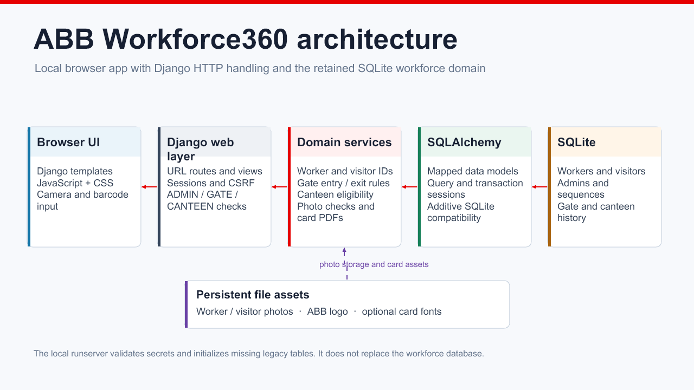
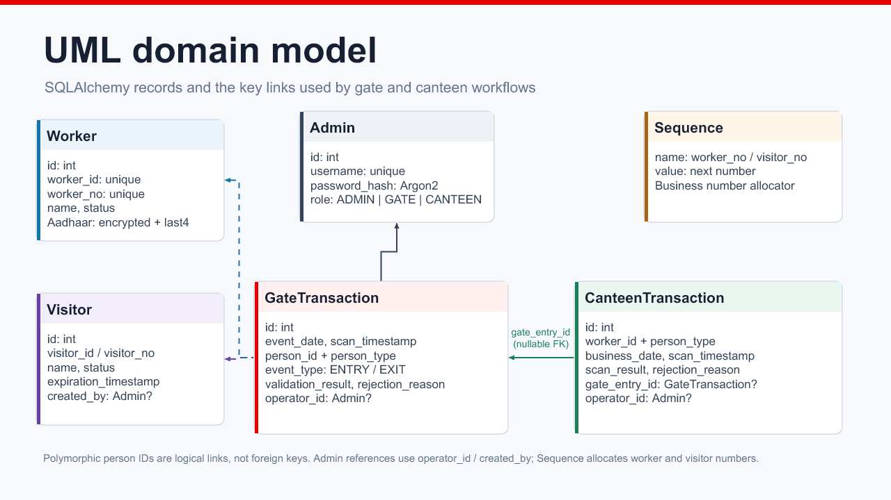

# ABB Workforce360

ABB Workforce360 is a local workforce operations application for ABB Plant 3. It manages worker records, visitor passes, gate entry and exit, canteen scans, and identity-card PDFs.

## System diagrams

The editable PowerPoint contains a component architecture diagram and a UML domain model. The PNG previews below are exported from those slides.

[Download the editable UML PowerPoint](docs/diagrams/Workforce360-UML.pptx)

### Application architecture



### Domain model



## Features

- Register and manage workers, including status changes and photo uploads.
- Register visitors and issue passes that expire at the end of the registration day in the configured site timezone.
- Record accepted and rejected gate scans. Accepted scans follow the daily entry and exit rules implemented by the gate service.
- Record canteen scans for eligible workers and visitors. The service permits one successful meal scan per person per business day and requires an accepted gate entry that day.
- View dashboard counts and filter gate and canteen transaction reports by date and result.
- Generate worker and visitor identity-card PDFs.
- Apply operator roles: `ADMIN`, `GATE`, and `CANTEEN`.

## Architecture

The browser UI uses Django templates, CSS, and browser-native JavaScript. Django handles HTTP routes, sessions, CSRF protection, and role checks. The existing SQLAlchemy models and domain services continue to use the existing SQLite tables for workforce data. Uploaded photos and other file assets live outside the database.

This project runs locally with Django's development server. It is configured to bind to loopback and is not a production deployment.

### Main directories

| Path | Purpose |
| --- | --- |
| `workforce360/` | Django settings, URL configuration, and WSGI entry point |
| `webapp/` | Django views and forms, templates, static assets, and local `runserver` command |
| `backend/models.py`, `backend/db.py` | SQLAlchemy schema and SQLite setup |
| `backend/services/` | Gate, canteen, identity, visitor, photo, timezone, and card logic |
| `assets/` | Source assets used by card generation |
| `data/` | Local database and uploaded photos; ignored by Git |
| `tests/` | Django adapter and domain-rule tests |
| `docs/diagrams/` | Editable UML PowerPoint and README preview images |

## Requirements

- Python 3.11 or newer
- Git
- PowerShell on Windows, or a POSIX-compatible shell
- No Node.js or frontend package manager is needed to run the application

## Local setup

### Windows PowerShell

```powershell
Copy-Item .env.example .env
py -3.11 -m venv .venv
.\.venv\Scripts\Activate.ps1
python -m pip install --upgrade pip
python -m pip install -r requirements.txt
```

### macOS or Linux

```sh
cp .env.example .env
python3 -m venv .venv
. .venv/bin/activate
python -m pip install --upgrade pip
python -m pip install -r requirements.txt
```

### Configure secrets and local paths

Edit `.env` before starting. Set unique random values of at least 32 bytes for:

- `WIR_SESSION_SECRET`
- `WIR_WORKER_ID_SECRET`

Keep the same `WIR_WORKER_ID_SECRET` for an existing database because generated worker IDs depend on it. Visitor IDs use `WIR_VISITOR_ID_SECRET` when configured; otherwise they use the worker ID secret.

Set `WIR_AADHAAR_ENCRYPTION_KEY` to a Fernet key before registering records that contain Aadhaar data. Generate one with:

```sh
python -c "from cryptography.fernet import Fernet; print(Fernet.generate_key().decode())"
```

Keep the original encryption key for an existing database. Without a valid key, Aadhaar registration is unavailable.

The example configuration uses:

- `WIR_DATABASE_URL`: SQLite at `data/wir.sqlite3`
- `WIR_UPLOAD_DIR`: worker photo storage
- `WIR_VISITOR_UPLOAD_DIR`: visitor photo storage
- `WIR_LOGO_PATH`: ABB logo used by generated cards
- `WIR_SITE_TIMEZONE`: site timezone; defaults to `Asia/Kolkata`
- `WIR_COOKIE_SECURE`: enable secure cookies when HTTPS is configured

Paths can be relative to the repository root or absolute. Keep the database and uploads in persistent storage. Never commit `.env`, `secrets.md`, database files, or real photos.

### Create an operator account

For a new installation, create an administrator or role-specific operator:

```sh
python -m backend.create_admin
```

The command prompts for a username, role (`ADMIN`, `GATE`, or `CANTEEN`), and a password of at least 14 characters. Existing installations should keep their existing accounts and secrets.

### Start the application

```sh
python manage.py runserver
```

Open [http://127.0.0.1:8000](http://127.0.0.1:8000). To choose another local port:

```sh
python manage.py runserver 8010
```

The custom command validates required secrets, initializes missing legacy tables, applies the existing additive SQLite compatibility updates, and binds the development server to loopback.

## Role access

| Role | Main access |
| --- | --- |
| `ADMIN` | Dashboard, workers, visitors, gate operations and reports, canteen operations and reports |
| `GATE` | Worker lookup, visitor management, gate operations and gate reports |
| `CANTEEN` | Worker lookup, canteen operations and canteen reports |

State-changing requests use Django CSRF protection. Passwords are stored as Argon2 hashes. Aadhaar values are encrypted at rest when the encryption key is configured and are masked in list responses.

## API overview

All paths are relative to the local server root. Protected routes require an authenticated session and the listed role.

| Route | Purpose | Roles |
| --- | --- | --- |
| `GET /api/health` | Database health check | Public |
| `POST /api/auth/login` | Start an operator session | Public |
| `GET /api/auth/me`, `POST /api/auth/logout` | Read or end the session | Signed-in |
| `GET /api/summary` | Worker counts | All roles |
| `GET/POST /api/workers` | Search/list or register workers | All roles |
| `GET /api/workers/search`, `GET /api/workers/{id}` | Worker lookup and details | All roles |
| `PATCH /api/workers/{id}/status` | Update worker status | All roles |
| `GET /api/workers/{id}/photo`, `GET /api/workers/{id}/id-card` | Worker photo or PDF card | All roles |
| `POST /api/gate/scan`, `GET /api/gate/transactions`, `GET /api/gate/report` | Gate scans and reports | `ADMIN`, `GATE` |
| `GET/POST /api/visitors`, `GET /api/visitors/{id}` | Visitor registration and lookup | `ADMIN`, `GATE` |
| `GET /api/visitors/{id}/photo`, `GET /api/visitors/{id}/id-card` | Visitor photo or PDF pass | `ADMIN`, `GATE` |
| `POST /api/canteen/scan`, `GET /api/canteen/transactions`, `GET /api/canteen/report` | Canteen scans and reports | `ADMIN`, `CANTEEN` |

## Tests and checks

Install the test dependencies when needed:

```sh
python -m pip install -r requirements-test.txt
```

Run the Django checks and test suites:

```sh
python manage.py check
python manage.py test tests.test_django_web --verbosity 2
python -m pytest -q --basetemp=.pytest-work
```

Tests use isolated databases and temporary files. They should not use the local workforce database.

## Data and backups

The default database is `data/wir.sqlite3`; uploaded worker and visitor photos are stored under `data/uploads/`. Stop the application before copying the SQLite database and photo folders. Back up `.env` securely alongside the data because its secrets are required to preserve existing worker IDs and decrypt stored Aadhaar values. Do not reset or delete the existing database as a setup step.

## Known limits

The repository is configured for local development: Django `DEBUG` is enabled, allowed hosts are loopback, and the custom server command rejects non-local bind addresses. No production deployment, Docker setup, or LAN hosting is provided.
